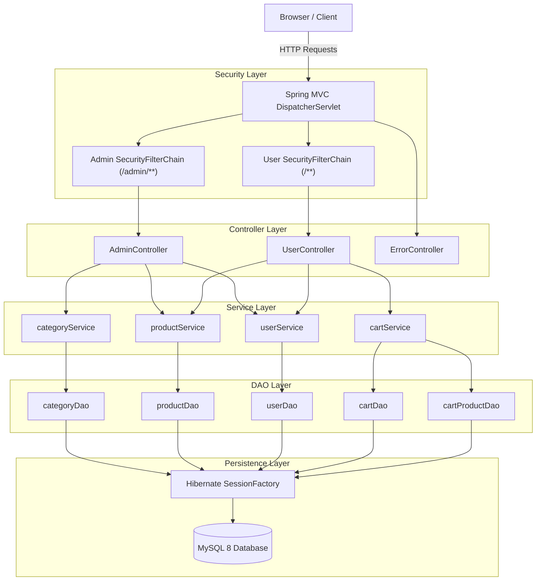

# 🛒 Spring Boot E-Commerce Platform

A robust, full-featured e-commerce web application built with **Spring Boot 3.2.5**, **Java 21**, **Spring Security 6**, **Hibernate ORM**, and **JSP (Jakarta JSTL)**. Features role-based access control, dual security filter chains, custom Hibernate session management, and a clean layered MVC architecture.

---

<p align="center">
  
  
  
  
  
  
  
</p>

---

## 📌 Table of Contents

- [Overview](#-overview)
- [Key Features](#-key-features)
- [System Architecture](#-system-architecture)
- [Tech Stack](#-tech-stack)
- [Project Structure](#-project-structure)
- [Prerequisites](#-prerequisites)
- [Quick Start Guide](#-quick-start-guide)
  - [1. Clone Repository](#1-clone-repository)
  - [2. Database Setup](#2-database-setup)
  - [3. Configure Application](#3-configure-application)
  - [4. Build & Run](#4-build--run)
- [Default Credentials](#-default-credentials)
- [Core Endpoints & Routes](#-core-endpoints--routes)
- [Security Architecture](#-security-architecture)
- [CI/CD & Testing](#-cicd--testing)
- [Roadmap](#-roadmap)
- [Contributing](#-contributing)
- [License](#-license)

---

## 🌟 Overview

This application serves as a comprehensive e-commerce reference implementation following enterprise Java best practices. It showcases:
- Separation of concerns through **Controller-Service-DAO** layered design.
- Direct **Hibernate SessionFactory** orchestration with declarative transactions.
- Dual-context **Spring Security 6** architecture isolating administrative operations from customer storefronts.
- Automated **BCrypt** password migration supporting backward compatibility for legacy seeds.
- Non-blocking startup resilience with Spring lazy initialization.

---

## ✨ Key Features

### 👤 Customer Experience
* **User Authentication**: Registration with real-time username availability validation and secure login.
* **Product Catalog**: Browse inventory with image previews, category tags, weight specifications, and real-time pricing.
* **Cart System**: Multi-item cart management with session persistence and quantity updates.
* **Profile Management**: View and modify personal profile details, delivery addresses, and login credentials.

### 🛡️ Admin Management Portal
* **Dashboard Overview**: Administrative central hub for platform management.
* **Category Operations**: Full CRUD lifecycle (create, view, update, delete) for product categorization.
* **Product Management**: Add, update, and remove products with details including prices, stock quantity, weights, descriptions, and media URLs.
* **Customer Management**: Audit registered users, addresses, emails, and permissions.

### 🔐 Security & Persistence
* **Spring Security 6**: Multiple `SecurityFilterChain` beans segregating `/admin/**` and user endpoints.
* **Password Encryption**: `BCryptPasswordEncoder` hashing with automatic legacy plaintext migration on login.
* **Custom Hibernate SessionFactory**: Uses `LocalSessionFactoryBean` and `HibernateTransactionManager` for fine-grained persistence handling.
* **Database Resilience**: Configured with `spring.main.lazy-initialization=true` to allow graceful boot even if DB connections are initially pending.

---

## 🏛️ System Architecture



---

## 🛠️ Tech Stack

| Component | Technology | Version / Details |
| :--- | :--- | :--- |
| **Language** | Java | 21 (LTS) |
| **Framework** | Spring Boot | 3.2.5 |
| **Security** | Spring Security | 6.x |
| **ORM / Persistence** | Hibernate ORM | 6.x (via `LocalSessionFactoryBean`) |
| **Database** | MySQL | 8.x Connector/J (8.3.0) |
| **View Template** | JSP & Jakarta JSTL | Tomcat Embed Jasper |
| **Build Tool** | Apache Maven | 3.8+ / Maven Wrapper included |
| **Testing** | JUnit 5 | 5.10.0 + Spring Boot Test |

---

## 📂 Project Structure

```text
E-commerce-project-springBoot/
├── .mvn/wrapper/                  # Maven wrapper configuration
├── src/
│   ├── main/
│   │   ├── java/com/jtspringproject/JtSpringProject/
│   │   │   ├── configuration/
│   │   │   │   ├── PasswordEncoderConfig.java     # BCrypt encoder bean
│   │   │   │   └── SecurityConfiguration.java     # Dual SecurityFilterChains
│   │   │   ├── controller/
│   │   │   │   ├── AdminController.java           # Admin dashboard & management
│   │   │   │   ├── UserController.java            # Customer storefront & profile
│   │   │   │   └── ErrorController.java           # HTTP 403 & error mapping
│   │   │   ├── dao/
│   │   │   │   ├── cartDao.java                   # Cart persistence
│   │   │   │   ├── cartProductDao.java            # Cart item relational mapping
│   │   │   │   ├── categoryDao.java               # Category persistence
│   │   │   │   ├── productDao.java                # Product persistence
│   │   │   │   └── userDao.java                   # User persistence & existence
│   │   │   ├── models/
│   │   │   │   ├── Cart.java                      # Cart entity
│   │   │   │   ├── CartProduct.java               # Cart-product associative entity
│   │   │   │   ├── CartProductId.java             # Composite key for cart items
│   │   │   │   ├── Category.java                  # Product category entity
│   │   │   │   ├── Product.java                   # Product entity
│   │   │   │   └── User.java                      # Customer/Admin user entity
│   │   │   ├── services/
│   │   │   │   ├── cartService.java               # Cart operations
│   │   │   │   ├── categoryService.java           # Category business logic
│   │   │   │   ├── productService.java            # Product catalog operations
│   │   │   │   └── userService.java               # Auth & profile management
│   │   │   ├── HibernateConfiguration.java        # SessionFactory & transaction manager
│   │   │   └── JtSpringProjectApplication.java    # Spring Boot entry point
│   │   ├── resources/
│   │   │   ├── application.properties             # Database, port & view resolvers
│   │   │   └── Product Images/                    # Bundled product media
│   │   └── webapp/views/                          # JSP view templates
│   │       ├── adminHome.jsp                      # Admin dashboard
│   │       ├── adminlogin.jsp                     # Admin authentication page
│   │       ├── categories.jsp                     # Category CRUD panel
│   │       ├── displayCustomers.jsp               # Registered customer audit
│   │       ├── index.jsp                          # Customer storefront
│   │       ├── products.jsp                       # Admin inventory view
│   │       ├── productsAdd.jsp                    # Product creation form
│   │       ├── productsUpdate.jsp                 # Product edit form
│   │       ├── register.jsp                       # Customer registration
│   │       ├── updateProfile.jsp                  # User profile management
│   │       ├── uproduct.jsp                       # Product browser
│   │       ├── userLogin.jsp                      # Customer login page
│   │       └── 403.jsp                            # Access denied error page
│   └── test/java/                                 # Unit and integration test suites
├── basedata.sql                                   # Database schema & initial seed data
├── jenkins file                                   # CI/CD pipeline definition
├── mvnw / mvnw.cmd                                # Cross-platform Maven wrappers
├── pom.xml                                        # Maven project dependencies & build
└── roadmap.md                                     # Future milestones and technical backlog
```

---

## 📋 Prerequisites

Before running the application, ensure the following are installed:
- **Java Development Kit (JDK) 21** or higher
- **MySQL Server 8.0+**
- **Git**

---

## 🚀 Quick Start Guide

### 1. Clone Repository

```bash
git clone https://github.com/ParthThakkarR/ecommerce-springboot.git
cd ecommerce-springboot
```

### 2. Database Setup

1. Start your local MySQL service.
2. Run the provided `basedata.sql` script to create the database schema and populate seed data:

```bash
mysql -u root -p < basedata.sql
```

> **Note:** The script creates the `ecommjava` database, sets up `CATEGORY`, `CUSTOMER`, and `PRODUCT` tables, and seeds initial administrator and customer accounts.

### 3. Configure Application

Edit `src/main/resources/application.properties` to match your MySQL server credentials:

```properties
server.port=8080
spring.mvc.view.prefix=/views/
spring.mvc.view.suffix=.jsp

# Database Configuration
db.driver=com.mysql.cj.jdbc.Driver
db.url=jdbc:mysql://localhost:3306/ecommjava?createDatabaseIfNotExist=true
db.username=root
db.password=your_mysql_password

# Hibernate Configuration
hibernate.dialect=org.hibernate.dialect.MySQLDialect
hibernate.show_sql=true
hibernate.hbm2ddl.auto=none
entitymanager.packagesToScan=com

# Startup Resilience
spring.main.lazy-initialization=true
```

### 4. Build & Run

Run using the included Maven Wrapper:

**Linux / macOS:**
```bash
./mvnw clean spring-boot:run
```

**Windows (PowerShell / Command Prompt):**
```cmd
mvnw.cmd clean spring-boot:run
```

Once started, access the application in your browser:
- **Storefront**: [http://localhost:8080/](http://localhost:8080/)
- **Admin Portal**: [http://localhost:8080/admin/login](http://localhost:8080/admin/login)

---

## 🔑 Default Credentials

The `basedata.sql` seed script provides default testing credentials:

| Role | Username | Password | Assigned Role | Portal URL |
| :--- | :--- | :--- | :--- | :--- |
| **Administrator** | `admin` | `123` | `ROLE_ADMIN` | [http://localhost:8080/admin/login](http://localhost:8080/admin/login) |
| **Customer** | `lisa` | `765` | `ROLE_NORMAL` | [http://localhost:8080/login](http://localhost:8080/login) |

> 🔒 **Security Notice**: Upon first successful login, the application automatically hashes plain-text seed passwords using `BCryptPasswordEncoder` to guarantee security.

---

## 🌐 Core Endpoints & Routes

### 👤 Customer Endpoints
| HTTP Method | Route | Description | Access |
| :--- | :--- | :--- | :--- |
| `GET` | `/` | Storefront landing page & products list | Authenticated (`USER`) |
| `GET` | `/login` | Customer login view | Public |
| `POST` | `/userloginvalidate` | Process customer authentication | Public |
| `GET` | `/register` | User registration view | Public |
| `POST` | `/newuserregister` | Create customer account | Public |
| `GET` | `/user/products` | Browse product inventory | Authenticated (`USER`) |
| `GET` | `/profileDisplay` | View customer profile | Authenticated (`USER`) |
| `POST` | `/updateuser` | Update personal customer details | Authenticated (`USER`) |
| `GET` | `/logout` | Customer session logout | Authenticated (`USER`) |

### 🛡️ Admin Endpoints
| HTTP Method | Route | Description | Access |
| :--- | :--- | :--- | :--- |
| `GET` | `/admin/login` | Admin login view | Public |
| `POST` | `/admin/loginvalidate`| Process admin authentication | Public |
| `GET` | `/admin/` or `/admin/Dashboard` | Admin central control dashboard | Role `ADMIN` |
| `GET` | `/admin/categories` | List product categories | Role `ADMIN` |
| `POST` | `/admin/categories` | Add a new product category | Role `ADMIN` |
| `POST` | `/admin/categories/update` | Update existing category | Role `ADMIN` |
| `POST` | `/admin/categories/delete` | Remove a category | Role `ADMIN` |
| `GET` | `/admin/products` | View all catalog products | Role `ADMIN` |
| `GET` | `/admin/products/add` | Product creation view | Role `ADMIN` |
| `POST` | `/admin/products/add` | Submit new product | Role `ADMIN` |
| `GET` | `/admin/products/update/{id}` | Edit product view | Role `ADMIN` |
| `POST` | `/admin/products/update/{id}` | Submit product updates | Role `ADMIN` |
| `POST` | `/admin/products/delete` | Delete product by ID | Role `ADMIN` |
| `GET` | `/admin/customers` | Audit all registered users | Role `ADMIN` |
| `GET` | `/admin/logout` | Terminate admin session | Role `ADMIN` |

---

## 🔒 Security Architecture

The application implements a dual-adapter configuration using Spring Security 6:

1. **Admin Filter Chain (`@Order(1)`)**:
   - Matches pattern `/admin/**`.
   - Protects administrative paths behind the `ADMIN` role.
   - Dedicated login handler (`/admin/loginvalidate`) and redirect policies.

2. **User Filter Chain (`@Order(2)`)**:
   - Matches standard storefront routes.
   - Permits unauthenticated access only to `/login`, `/register`, and `/newuserregister`.
   - Restricts all remaining application paths to authenticated users with `USER` role.

3. **Transparent Password Upgrade**:
   - In `userService.java`, any legacy credentials detected without a standard BCrypt prefix (`$2a$`, `$2b$`, `$2y$`) are re-encoded and saved upon retrieval.

---

## 🧪 CI/CD & Testing

### Running Tests

Execute unit and integration test suites:

```bash
./mvnw clean test
```

For full verification and packaging:

```bash
./mvnw clean verify
```

### Jenkins CI/CD Pipeline
A sample declarative Jenkins pipeline is provided in `jenkins file` with stages covering:
- **Checkout**: Pulling source repository.
- **Build**: Compiling with Maven (`mvn -B -DskipTests clean package`).
- **Test**: Executing test suites (`mvn test`).
- **Deploy**: Staging artifact distribution.

---

## 🗺️ Roadmap

Refer to [roadmap.md](roadmap.md) for planned platform enhancements, including:
- [x] Spring Boot 3.2.5 and Java 21 migration.
- [x] Dual Spring Security 6 architecture.
- [ ] Docker Compose orchestration for app and MySQL containers.
- [ ] Flyway database migrations.
- [ ] Multipart image upload service with cloud storage abstraction.
- [ ] Global exception handler (`@ControllerAdvice`) and REST API endpoints.

---

## 🤝 Contributing

Contributions are always welcome!
1. Fork the repository.
2. Create your feature branch (`git checkout -b feature/amazing-feature`).
3. Commit your changes (`git commit -m 'feat: add amazing feature'`).
4. Push to the branch (`git push origin feature/amazing-feature`).
5. Open a Pull Request.

---

## 📄 License

This project is licensed under the MIT License - see the LICENSE file for details.
